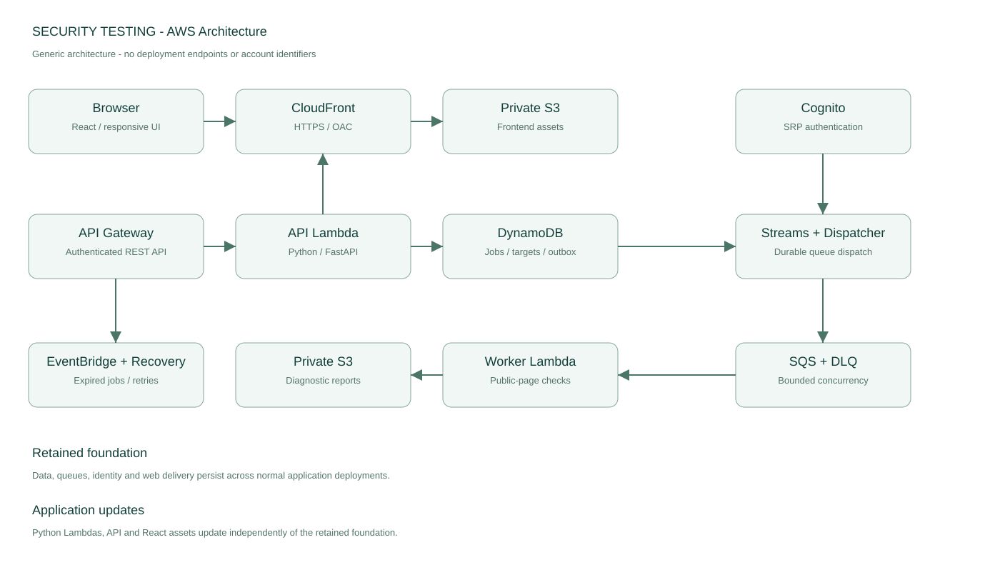
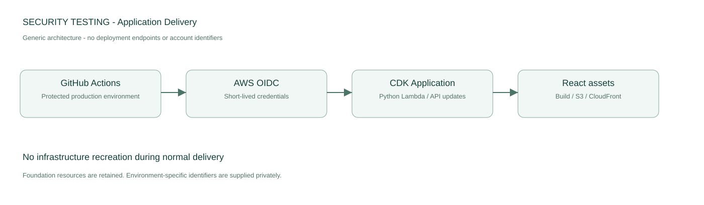

# security_testing

React + Pythonのモノレポ。クリーンアーキテクチャで、公開Webページの設定を低負荷で診断します。

**ローカル起動: http://localhost:5173 。AWSの接続先・設定は公開リポジトリに含めません。**
診断手順はURL登録→診断開始→深刻度・改善方法の確認です。所有確認とシステム重要度の事前設定は不要です。
LocalStackではログイン・登録・診断・結果表示・再診断比較まで実機確認済みです。
詳細な確認状況・残作業は [docs/status.md](docs/status.md) を参照してください。
AWSのログインはReactで自作した画面を使用します。Cognitoの外部画面へ遷移せず、SRP認証を行います。
公開画面・Cognito接続・実ユーザーの本番診断成功を確認済みです。本番送信経路制御などの残作業はstatus.mdに記載しています。

## ログイン

トップページは紹介画面です。「ログイン」を押すと、未ログインなら自作フォーム、ログイン済みなら直接ダッシュボードへ進みます。
ログイン画面でメールアドレス（またはユーザー名）と既存パスワードを入力します。
`/` は紹介、`/login` はログイン、`/dashboard` は認証必須の診断ワークスペースです。
表示切替、処理中表示、認証エラー、確認コード、パスワード再設定をサイト内で扱います。
AWS公式SDKでCognitoへ直接接続し、アプリのPython APIへパスワードを送りません。
認証情報のキャッシュはsessionStorage。Cognitoの署名・client・専用グループをAPIでも検証します。
ローカルは従来のKeycloak / Authorization Code + PKCEを維持します。

本番ログイン画面のブラウザ検証:
`LOGIN_BASE_URL=https://security-testing.example.com/ PLAYWRIGHT_CHANNEL=chrome pnpm --filter @security-testing/web test:e2e login.e2e.ts --workers=1`。
存在しないテスト識別子での拒否を確認し、既存ユーザーのパスワードや再設定メールを使用しません。

## 診断履歴・PDF・削除

1. ダッシュボード下部の「診断履歴」で、出力したい行の「PDF ↓」を押します。表示中の結果とは独立して、その履歴のPDFを取得します。
2. 完了した診断にはURL・日時・全チェックの説明・判定基準・観測根拠・改善方法・CVSSの前提と指標を出力します。過去の保存結果にも現行の説明・評価基準を適用し、PDF作成時に再診断しません。失敗・キャンセルした履歴は、その状態と確認できなかった理由を出力します。実行中はPDFを取得できません。
3. 各チェックの「?」で内容と必要な理由、根拠欄の「?」で判定基準を確認できます。PCはマウス・キーボード、スマートフォンはタップで表示し、外側のタップかEscapeで閉じます。
4. 履歴の「削除」はその診断結果への参照を停止します。診断対象の「削除」は対象と関連履歴を一覧から除外します。どちらも確認を表示し、実行中の診断を停止します。削除は即時参照拒否による論理削除です。保存データは既存の30日TTL/S3ライフサイクル、監査記録は90日で期限管理します。画面からの復元機能はありません。

CVSSは公式計算式に従うv4.0の数値です。ただし公開ページの設定だけでは悪用を確認できないため、**追加の攻撃条件が成立すると仮定した参考評価**として表示します。「採点の前提・指標」でベクトルと全指標の根拠を確認できます。サーバー識別情報の公開だけなど、影響を特定できない項目は「適用外」とし、0.0を割り当てません。未実施も安全とは扱いません。

「どこに注意が必要？」では、通信の盗み見・不正なプログラム実行・クリック誘導・ログイン状態の悪用・識別情報の公開を、観測した所見から整理します。場所・被害・成立に必要な条件・対策を平易な言葉で説明し、PDFにも含めます。内訳は改善候補の件数で、攻撃の発生率や成功率ではありません。SQLインジェクション、DDoS、認証突破など未評価の領域も明示します。

**AI分析は工事中です。** 画面のボタンは無効です。将来のOpenAI API向けにPythonの`AiAnalyzer`インターフェースと認証付きの準備状態APIを用意しました。今回はOpenAIへデータを送らず、APIキーも不要です。[接続時の設計](docs/ai-analysis.md)を参照してください。

日本語PDFにはZen Kaku Gothic Newを埋め込みます。[フォントのOFLライセンス](services/backend/src/site_diagnostics/adapters/outbound/assets/OFL.txt)と[配布元](https://github.com/google/fonts/tree/main/ofl/zenkakugothicnew)を同梱・明記しています。PDFは認証付きAPIから取得し、公開S3 URLやトークン付きURLを作りません。API Gatewayのバイナリー応答をCDKで設定しています。

制御下のfixtureで機能全体を検証するコマンド：`E2E_REPORTS=1 PLAYWRIGHT_CHANNEL=chrome pnpm --filter @security-testing/web test:e2e reports.e2e.ts --workers=1`。このテストで新規作成した対象と履歴だけを削除します。

## システム構成図



青枠は通常配信で再作成しないFoundation、橙枠はApplication、灰枠は既存・外部資源です。
図はCDKの接続構成に基づく公開用の概略図です。AWSアイコン付きの編集用draw.ioも同梱しています。
実環境のURL・アカウント・識別子は図に含めません。
[編集用draw.io（2ページ）](docs/diagrams/aws-architecture.drawio) / [テキスト版の構成説明](readme.txt)

## 前提
Node.js 24、pnpm 11.25.0、Python 3.13、uv、Docker Compose。
Rancher DesktopではMoby(dockerd)を使用してください。
LocalStackはアカウントに紐づく有効な認証トークンが必要です（AWSのアクセスキーとは別）。
トークンの取得や有料契約を自動化していません。

## 最初の起動

1. `make bootstrap` でロック済み依存関係を取得します。
2. `.env.example` を `.env` にコピーし、`LOCALSTACK_AUTH_TOKEN` を設定します。既に `.env` があれば上書きしません。
3. `make local-up` でLocalStack・Keycloak・診断用fixtureを起動します。
4. `make local-deploy` でLinux向けLambdaを構築し、明示的なlocalhost:4566へスタックを作成します。API・キュー接続先は `.env` へ自動反映されます。
5. `make dev-web` を起動して http://localhost:5173 を開きます。

Docker contextは `rancher-desktop`。権限によっては `DOCKER_HOST=unix://$HOME/.rd/docker.sock` を指定します。
ComposeのDocker socketマウントはLinux VM内のソケットを利用します。
`make local-deploy` は実AWSへ接続しない専用スクリプトです。CDKのAWS deployは実行しません。
完了確認例：

```bash
AWS_ACCESS_KEY_ID=test AWS_SECRET_ACCESS_KEY=test aws --endpoint-url http://localhost:4566 \
  --region ap-northeast-1 cloudformation describe-stacks --stack-name SecurityTesting
```

API Gatewayのローカル公開URLは環境ごとに確認してください。API URLを勝手に実AWSの形式へ置き換えません。
FEは `.env` をルートから読みます。設定変更後はViteを再起動します。

## 診断を試す（制御下のサイトのみ）

Keycloakのローカル専用ユーザー `developer` / `local-development-only` でログインします。
対象URLは `http://fixture.security-testing.test/`。この名前はLambdaコンテナ内でのみ解決します。
URLを登録し、「診断を開始」を押します。確認ファイルの配置や質問票への回答は不要です。
診断中は進行状況を表示し、完了後に結果を自動表示します。CVSSは追加条件を明記した参考評価と、採点対象外・未実施を区別します。
設定改善後の変化は以下で試せます（HTTP利用と識別ヘッダー等の指摘は残る場合があります）。

```bash
.venv/bin/python scripts/fixture.py secure
docker compose exec fixture nginx -s reload
```

再診断は、同じ対象を選んで「診断を開始」。受付間隔60秒、ホスト待機120秒です。
比較APIはOpenAPIを参照。未実施項目を解消として比較しません。

## 開発・検証

`make test` : PythonとFEのテスト。AWS通信にはMoto、診断対象にはFakeFetcherを使用。
これはLocalStack実機E2Eとは別です。
`make check` : Ruff、mypy、依存方向、ESLint、FEビルド。
`make generate` : OpenAPIとFEクライアント型を再生成。
`make synth` : インフラのテンプレート合成（事前に `make package`）。
`make dev-api` : ホストのUvicornによる高速開発。`.env`にQueueUrl等を指定。Lambda検証の代わりにはなりません。
`make local-down` : ローカルコンテナを停止。

## 設計資料

[設計とADR](docs/architecture.md) / [評価ルール](docs/evaluation.md) /
[LocalStack差分](docs/localstack.md) / [運用とAWS移行](docs/operations.md) / [費用の前提](docs/cost.md) /
[AWS環境とリリース](docs/aws-deployment.md) / [依頼原文](docs/requirements.txt) / [OpenAPI](contracts/openapi.json)

AWSへ初回デプロイ済みのMVPです。ユーザー登録対象の実サイト診断は未実施です。

## AWS初回構築と通常リリース

`make aws-initial AWS_PROFILE=default` で基盤・アプリを構築、`make github-production AWS_PROFILE=default` でGitHub設定を同期します。
2回目以降は `make aws-app AWS_PROFILE=default` でApplicationだけを更新します。
**通常配信の対象は、PythonバックエンドとReactフロントエンドの両方です。**

| 順序 | 処理 | 更新対象 |
| --- | --- | --- |
| 1 | PythonコードとLinux向け依存関係をパッケージ化 | FastAPI、診断・配送・復旧処理 |
| 2 | CDKでApplicationをデプロイ | API / Worker / Dispatcher / Recoveryの4 Lambda、REST API、イベント連携 |
| 3 | Reactを本番設定でビルド | JavaScript / CSS / HTML |
| 4 | S3へ配置してCloudFrontを無効化 | フロント配信資産・キャッシュ |

Pythonに変更差分がなければ、CDKはLambda更新を省略します。Reactの配信だけが進んだように見える場合も、Pythonの更新判定は先に実行されています。
FoundationのDynamoDB・S3・SQS・認証設定などは、通常リリースのデプロイ対象から外します。保存先のS3バケットを作り直すことと、中のReactファイルを更新することは別です。



GitHubのproduction EnvironmentにはOIDCロールと接続情報を設定済みです。
mainへのコード変更で、OIDC接続してアプリ更新が動きます。ドキュメントのみの変更では配信しません。
既存Cognitoユーザープールと専用利用者グループを使用し、既存パスワードは変更しません。
詳しくは[AWS配信手順](docs/aws-deployment.md)を参照してください。

## 実機E2E
Rancher Desktopが起動した状態で `PLAYWRIGHT_CHANNEL=chrome pnpm --filter @security-testing/web test:e2e`。
Google Chromeを使用します。別環境ではPlaywrightのChromiumを用意し、channel指定を省略できます。
テストはローカルKeycloakにログインし、fixtureだけを診断します。公開サイトへ通信しません。
fixtureのヘッダーを一時的に改善し、再診断と差分を確認した後、元の設定へ戻します。
レート制限を無効化しないため、ホスト待機時間を含み最大8分のテスト枠を設けています。

API Gateway v2は現在のLocalStackライセンス対象外のため、REST API v1をAWS・ローカル共通で使用します。
ローカルKeycloakにはsub発行のbasicスコープが必要です。`make local-up` で構成スクリプトを実行します。

## fixture隔離の検証
診断を一度実行した後、`.venv/bin/python scripts/check_fixture_network.py` で検証できます。
fixtureはinternalネットワークだけに所属し、固定ゲートウェイを経由した取得だけを許可します。
[実機検証の記録](docs/verification.md)を参照してください。

## 画面での進め方
サイト登録→診断開始→結果確認。対象サイトの所有者でなくても、公開ページの設定確認を実行できます。
検出した問題を暫定深刻度（高・中・低）の順に表示し、対応優先度と改善方法を示します。
システムの業務上の重要度を外部から推測しません。設定観測の暫定深刻度と、追加条件を仮定するCVSS参考評価を区別します。
診断中に画面を再読み込みしても、保存したジョブIDから最新状態を取得します。
スマートフォンの結果はカード表示です。

## 診断が完了しない場合
エラー表示は「ページを取得できず、結果が得られなかった」という意味です。脆弱性の検出とは区別します。
新しい失敗記録はDNS、接続、時間切れ、証明書、HTTPステータスなどを分けて説明します。
以前の一括エラー記録には詳細がなく、具体的な原因は断定できません。
管理下fixtureでの失敗表示検証は `E2E_FETCH_FAILURE=1 PLAYWRIGHT_CHANNEL=chrome pnpm --filter @security-testing/web test:e2e fetch-failure.e2e.ts --workers=1`。


## 公開資料と環境設定

実運用の接続先・AWS識別子・利用者情報・運用ログは含めません。
`infra/cdk/production.example.json`はダミー値です。実際の`production.json`はGit管理外に保持します。
GitHubの自動配信ではEnvironment Secretsを使用し、配信時だけ設定ファイルを作成します。
`security.yml`の検査内容と期限付きの設計例外は[セキュリティCI](docs/security-ci.md)を参照してください。
