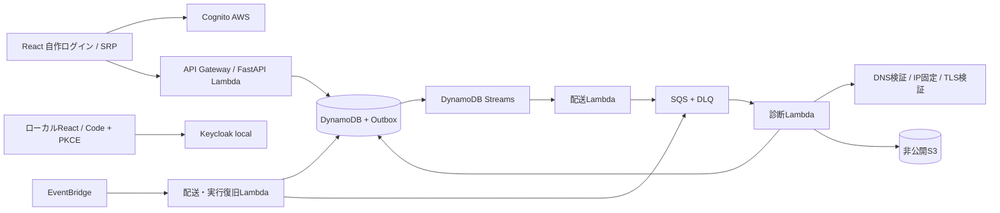

# 設計と判断

## 要件と範囲
公開された単一URLを低負荷で診断する。認証後・動的DOM・攻撃実証は対象外。
所有確認・事前質問票を廃止。対象サイトを所有しない利用者も公開ページの設定を診断できる。
対象URLのスキームとパスを固定し、リダイレクトを追跡しない。

依存方向は adapters → application → domain。bootstrapだけが具象を組み立てる。
DomainとApplicationはネットワーク、AWS、Pydantic、CVSS実装から独立。
FEのdomain/applicationもReact・HTTPクライアントを参照しない。
API DTOは外側に配置し、OpenAPIからTypeScriptクライアントの型を生成する。

## 画面
紹介トップ→ログイン→認証済みダッシュボード。ログイン済みでもトップを表示し、ボタンからダッシュボードへ進む。
ダッシュボードは対象登録、診断開始、ジョブ履歴・状態、深刻度順の診断結果。
JSON/HTMLレポート、比較、キャンセルはAPIからも利用可能。
削除APIはtombstoneを先に確定し、ワーカーの最終トランザクションで対象の版を確認。
物理削除と保持期限の実装状況はoperations.md参照。

## ADR-001: 単一ページ・非破壊検査
取得最大256 KiB、GETのみ、接続待ち5秒、取得全体15秒、1ページ、リダイレクト追跡0回。
圧縮された応答は拒否。DNS呼出しはOSのタイムアウトに従うためLambda全体60秒で上限を設ける。
ホスト実行ロック120秒、ユーザー受付60秒間隔・未完了2件、ワーカー同時2。
HTTP登録時はLocationの同一ホストHTTPS誘導を観測する。リダイレクト先は取得せず、HTTPS登録時のHTTP側は未実施。

## ADR-002: DynamoDB / Outbox
pk=認証済みsubject、sk=TARGET#id / JOB#id / OUTBOX#id / IDEMPOTENCY#hash / AUDIT#id。
ホストロックのみpk=HOST、sk=正規化ホスト。
work GSI: work_pk=OUTBOX/QUEUED/RUNNING、work_sk=受付時刻。
一覧はQueryのみ。現在のAPIページングはアプリ内offset方式（DB側のカーソル方式への変更が必要）。
revを用いた楽観ロックとTransactWriteItemsで、ジョブ・Outbox・冪等性キー・ユーザー制限を一括確定。
GSIは結果整合。配送済みイベントが再観測されても安全であることが前提。
レポートは実行版ごとに別キーで保存し、確定済みポインタからのみ取得。失敗時の孤立オブジェクトは30日で消去。

## ADR-003: 認証
ローカルはKeycloakのAuthorization Code + S256 PKCE。
本番はユーザー指定によりReactの自作フォームからAWS公式SDKでCognitoのUSER_SRP_AUTHを使用する。
共有User Poolを再利用し、専用clientへSRPとrefresh認証を明示設定。パスワードはPython APIを経由しない。
APIはJWTの署名（RS256）、issuer、exp、iat、sub、client_id/azp、token_useと必要scopeを検証。
本番のscopeはCognito API認証のaws.cognito.signin.user.admin、ローカルはopenid。
この予約scopeはCognitoの自己操作権限であり、アプリの管理者権限ではない。アプリ利用は専用グループも検証する。
IDトークンをAPIトークンとして使わない。本番ログインはHosted UIへ遷移しない。
SPAはsessionStorageに保存。XSS時の窃取リスクがあるためHTMLを実行しない。
JWT署名鍵は最大5分キャッシュ。本番でJWKS URL差替え・ローカルissuerは禁止。

## ADR-004: CVSS
設定不備だけから悪用条件を推定しない。全自動所見はCVSS=nullと理由を保存。
CVSS4計算Adapterは公式の最大・影響なしベクトルでテスト。現段階では手動所見登録・採点API/UIは未接続。
3.1の暗黙変換は実装しない。環境メトリクスを重要度レベルから自動生成しない。
実際にCVSSを付与するワークフローは追加実装が必要。画面で付与済みの値を捏造しない。

## ADR-005: AWS移行
CDKはPython3.13 Lambdaを作成、パッケージはLinux向けwheelで構築。
AWSの初回構築と独自ドメインでのCloudFront配信は実施済み。
REST APIの入口はアプリのJWT・専用グループ検証を必須とし、Gateway Authorizerは現段階では追加していない。
通常リリースではApplicationだけを指定し、Pythonの4 LambdaとReact配信資産を更新する。
本番ネットワーク送信制御と運用通知先は残作業。
[draw.ioのAWS構成図](diagrams/aws-architecture.drawio)と[現在の配信手順](aws-deployment.md)を参照。

## ADR-006: API Gateway REST APIへ統一（2026-11-01）
HTTP API(v2)は現在のLocalStack freemiumライセンス対象外で、CloudFormationがunknown IDを返した。
利用可能なREST API(v1)へCDKを切り替え、AWS・ローカルで同一のMangum/FastAPI処理を使用する。
API Gatewayのstageはlocal/AWSではv1。ローカルは/_aws/execute-api/{id}/localで接続しDNS依存を減らす。
REST APIはHTTP APIとはAWS料金や機能が異なる。費用計算ではREST APIの単価を用いる。
LocalStackの成功応答だけで完了とせず、実APIのGetRestApiで存在を確認してから.envを更新する。
Local用CDK accountは000000000000に固定し、ホスト側AWS設定の混入を防ぐ。
Lambda内のSDKはLocalStack専用接続先とtest認証情報を明示し、Lambdaが注入する資格情報を外部へ使わない。

## ADR-007: ローカルOIDCのsubjectと起動待ち
Keycloakのクライアントへbasicスコープを割り当て、subを発行する。
BEはsubの必須検証を維持し、username/emailによる代用はしない。
configure_identity.pyはローカルOIDCの準備を最大180秒待ち、既存クライアントにも冪等に設定を反映。
E2EのDOM待ちは15秒、初回API応答待ちは60秒。診断は既存のLambda・ホスト制限を維持して検証する。

## ADR-008: 事前条件の簡略化（2026-11-01）
最新のユーザー指示により所有確認・システム重要度質問票のAPI、処理、画面を削除。
既存レコードの確認期限・質問票データは参照せず、通常リリースでデータの削除・移行は行わない。
JWT認証、利用者単位の対象・結果の分離、SSRF防御、レート制限、ホストロックは維持する。
診断後に独自の暫定深刻度と優先度を計算し、CVSS未評価とは区別する。規則はevaluation.md。
旧レポートは深刻度を未評価として引き続き表示。新旧ルール版の比較は従来通り拒否する。

## ADR-009: 公開IPを全件検証し、IPv4を優先（2026-11-01）
VPC未接続の本番LambdaではIPv6の外向き接続を使えないため、DNS応答の単純な文字順では接続不能な候補が選ばれる。
全A/AAAA回答の公開IP検証を行った後、IPv4を優先する。非公開のAAAA回答を除外して処理を続けることはしない。
選択後は検証済みIPへ接続を固定し、元のホスト名でSNIと証明書を検証する。IPv6のみの対象は回答を破棄せず、現構成で到達できない場合は原因別の失敗として扱う。
ログは候補の件数と選択バージョンだけで、URL・実IP・秘密情報を記録しない。
